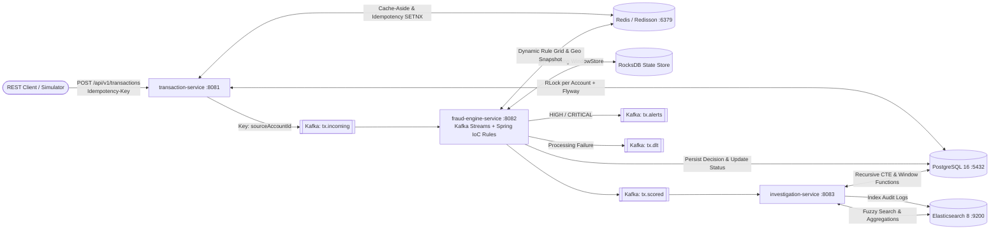

# AegisFlow — Real-Time Distributed Fraud Detection & Investigation Platform

AegisFlow is an event-driven, multi-service fraud detection and financial investigation platform built with **Java 21**, **Spring Boot 3.4**, **Apache Kafka & Kafka Streams**, **Redis / Redisson Data Grid**, **PostgreSQL 16**, and **Elasticsearch 8**.

---

## System Architecture



---

## Architecture & Engineering Highlights

| Technical Pillar | Implementation in AegisFlow | Key Source Files |
| :--- | :--- | :--- |
| **Multi-Module Clean Architecture** | Shared event contracts, domain enums, and standardized API envelopes decoupled from service implementations | `pom.xml`, `aegis-common/` |
| **Concurrency, Caching & Idempotency** | Redis `SETNX` idempotency guard (24h TTL + DB fallback), Spring Cache-Aside (`@Cacheable` / `@CacheEvict`), and Redisson `RLock` wrapping `TransactionTemplate` | `TransactionIngestionService.java`, `IdempotencyService.java`, `AccountProfileService.java` |
| **Spring IoC Pluggable Rule Engine** | Strategy pattern (`FraudRuleEvaluator`) auto-wired by `@Order`, toggled via `@ConditionalOnProperty` and `@ConfigurationProperties` | `RuleRegistry.java`, `BlacklistAccountRule.java`, `VelocitySpikeRule.java`, `AmountAnomalyRule.java`, `GeoImpossibleTravelRule.java` |
| **Functional Java Streams Pipeline** | Zero-imperative-loop scoring pipeline using `map`, `flatMap`, `Collectors.groupingBy`, and `reduce` with dynamic score capping | `RiskScoringService.java` |
| **Stateful Kafka Streams Topology** | Persistent RocksDB `WindowStore` (`FixedKeyProcessor`), Interactive Queries REST exposure, stream branching (`split()`), and Dead Letter Topic (`tx.dlt`) routing | `FraudDetectionTopology.java`, `VelocityEnrichmentProcessor.java`, `RuleManagementController.java` |
| **Distributed In-Memory Data Grid** | Redisson `RMap` (`TypedJsonJacksonCodec`) for hot-reloadable rule thresholds, last-seen geographic coordinates, and Redis `ZSET` exact 60s sliding windows | `DynamicRuleGridService.java` |
| **Advanced Native SQL (PostgreSQL 16)** | `WITH RECURSIVE` circular transfer detection (`A -> B -> C -> A`), Window Functions (`AVG`, `STDDEV_POP` Z-Score, `LAG`, running `SUM`, `DENSE_RANK`), `FILTER`, `PERCENTILE_CONT(0.95)`, and live `EXPLAIN ANALYZE` | `FraudAnalyticsNativeRepository.java`, `V1__init_schema.sql` |
| **Non-Relational Search & Analytics** | Elasticsearch 8 explicit field mappings, fuzzy multi-match investigation search, and real-time `terms` / `avg` / `date_histogram` aggregations | `FraudAuditDocument.java`, `ScoredEventConsumer.java`, `AuditSearchService.java` |
| **Automated Testing & Containerization** | JUnit 5 + Mockito rule tests, Kafka Streams `TopologyTestDriver` verification, non-root Alpine multi-stage `Dockerfile`, and full-stack `docker-compose.yml` | `RiskScoringServiceTest.java`, `FraudDetectionTopologyTest.java`, `Dockerfile`, `docker-compose.yml` |

---

## Quick Start (Full-Stack Docker Compose)

### 1. Start Infrastructure & All 3 Microservices
```bash
docker compose up -d --build
```

Wait ~30 seconds until all containers report `healthy`:
```bash
docker compose ps -a
```

### 2. Run End-to-End Fraud Scenario Simulator
```bash
chmod +x scripts/simulate-scenarios.sh
./scripts/simulate-scenarios.sh
```

The simulator automatically verifies health across ports `8081`–`8083` and executes:
1. **Normal Transaction + Idempotency Replay** (`replayed: false` followed by `replayed: true`).
2. **Velocity Spike Burst** (4 rapid transactions on `ACC-1004` within 1 minute).
3. **Impossible Travel + Extreme Amount Anomaly** (`ACC-1003` jumping from Surabaya to Tokyo with a `12,500,000 IDR` purchase).
4. **Blacklisted Entity Transfer** (`ACC-1002` transferring to sanctioned account `ACC-9999`).
5. **Live Verification** via Kafka Streams Interactive Queries, PostgreSQL Recursive CTE, and Elasticsearch Aggregations.

### 3. Run Unit & Kafka Streams Topology Tests
```bash
mvn clean test
```

---

## Service Endpoints Reference

| Service | Port | Key Endpoints |
| :--- | :--- | :--- |
| **transaction-service** | `8081` | `POST /api/v1/transactions` (requires `Idempotency-Key` header)<br>`GET /api/v1/transactions/{txId}`<br>`GET /api/v1/accounts/{accountId}`<br>`PATCH /api/v1/accounts/{accountId}` |
| **fraud-engine-service** | `8082` | `GET /api/v1/rules`<br>`GET /api/v1/rules/registered-beans`<br>`PUT /api/v1/rules/{ruleCode}`<br>`GET /api/v1/stream/velocity/{accountId}` |
| **investigation-service** | `8083` | `GET /api/v1/investigations/sql/circular-transfers`<br>`GET /api/v1/investigations/sql/amount-anomalies`<br>`GET /api/v1/investigations/sql/risk-leaderboard`<br>`GET /api/v1/investigations/sql/explain-plan`<br>`GET /api/v1/investigations/elastic/search`<br>`GET /api/v1/investigations/elastic/analytics` |
| **Kafka UI** | `8090` | Browser dashboard for inspecting topics (`tx.incoming`, `tx.scored`, `tx.alerts`, `tx.dlt`) and consumer lag |